# Deep-Dive Radiance Comparison of the Three Spectral-Sky Engines — Results

> **Doc map.** One of four spectral-engine docs:
> [comparison](spectral-engine-comparison.md) (engine-vs-engine) ·
> [radiance-deep-dive](spectral-engine-radiance-deep-dive.md) (angular & cross-city) ·
> [validation](spectral-engine-validation.md) (corrections & external cross-validation — canonical) ·
> [as-built](spectral-sky-as-built.md) (implementation ledger).
> **Owns:** the gensdaymtx angular path — circumsolar/horizon budget, fisheye renders, and the full-annual cross-city analysis.

> **Correction layers:** the faithful SEDES1 CCM, the anisotropic diffuse wrapper and the optional
> clear-sky bias are consolidated in
> **[spectral-engine-validation.md](spectral-engine-validation.md)**.

> **Status:** TOOLKIT BUILT & GATE-VALIDATED; **FULL-ANNUAL run done for 10 cities spanning 3.0°S–59.1°N**
> — the 3 Greek cities (Athens IWEC, Thessaloniki IWEC, Chania TMYx) plus **Singapore IWEC, Phoenix TMY2,
> London TMYx, Stockholm/Berga TMYx** and a dense humid-tropical group **(Manaus, Lagos, Mumbai TMYx)**
> (~4 316–4 385 daylight hours each). The **cross-city drivers are resolved and de-confounded**:
> the set spans latitude (3°S→59°N), aerosol (AOD 0.09→0.21) and humidity (PWV 1.5→4.8), and the
> SPECTRL2↔gensdaymtx colour gap is driven by **PWV / cloudiness** — partial **r = +0.37** holding latitude
> fixed, while latitude's apparent −0.73 collapses to **−0.09** holding PWV fixed; AOD is inert (−0.10). See
> **[Cross-city — the wider EPW set](#cross-city-the-wider-epw-set)** and the
> **[equator-vs-pole renders](#equator-vs-pole-singapore-vs-stockholm)** below; the per-city absolute +
> angular tables remain the trustworthy per-city result.
>
> **First pass (shape-only):** [`spectral-engine-comparison.md`](spectral-engine-comparison.md).
>
> **CCM variant.** Every overcast-CCT and mel-EDI figure below is computed under the shipped
> **re-anchored faithful Fig. 11** default. Verified against each CCM variant through the production path
> (Athens 12/12 hours across all clearness bins; Singapore and Stockholm 0/5 mismatches each). See
> [validation §2](spectral-engine-validation.md).

---

## What was built

Five inline, self-bootstrapping scripts (one-command runnable; no PYTHONPATH/VS Code), each realizing a
logical stage of the plan:

| Script                                                      | Role                                                                                                               | Gates                |
| ----------------------------------------------------------- | ------------------------------------------------------------------------------------------------------------------ | -------------------- |
| `patch_geometry.py`                                       | Reinhart/Tregenza**MF:1 dome** (145 sky patches; ground row excluded) + **cosine-weighted integrator** | **G1**         |
| `radiance_integrate.py` (`run_integrate.sh`)            | `.smx` → 20-band horizontal-diffuse irradiance + **angular metrics**                                      | **G2, G3, G4** |
| `engine_run.py`                                           | one hour, all three engines →**tidy CSV row** (Plane B, DHI-anchored)                                       | —                   |
| `annual_runs.py` (`run_annual.sh`)                      | per-city annual driver; gensdaymtx**once/year**, SMARTS **stratified subsample**                       | G5 (determinism)     |
| `aggregate.py` + `cross_city.py` (`run_aggregate.sh`) | bin by Kt × zenith × season; per-bin Δ tables + cross-city roll-up                                              | —                   |
| `make_plots.py` (`run_plots.sh`)                        | the charts below, straight from`out/<city>.csv` (matplotlib)                                                     | —                   |
| `render_fisheye.py` (`run_fisheye.sh`)                  | upward fisheye HDR renders of the Perez sky (gendaylit→rpict)                                                     | —                   |
| `render_engines_fisheye.py` (`run_engines_fisheye.sh`)  | per-engine fisheye comparison + true 20-band spectral fisheye from the`.smx`                                     | —                   |

`radiance_integrate.py`/`engine_run.py` build on the **G1-validated** `patch_geometry` dome (imported
from the same folder, self-bootstrapped onto `sys.path`) rather than re-deriving 145 patches per script
— the integrator is shared, so the π anchor protects every downstream number.

## The bridge (how gensdaymtx becomes comparable)

`gensdaymtx` emits per-patch **radiance**; SPECTRL2/SMARTS emit horizontal **irradiance**. The dome
integrator converts the former to the latter via the cosine-weighted solid-angle sum

```
E_diffuse(λ) = Σ_sky-patches  L_patch(λ) · cw_patch       cw = ∫_patch cosθ dΩ
```

Using the **analytic** cosine-weighted solid angle `cw` (not the midpoint `ω·cosθ`) makes the unit-radiance
integral telescope to **exactly π** — gate G1 passes to machine precision (`|E − π| = 5e-15`). This
integrator turns out to be structurally identical to gendaymtx's own `CalcRelHorzIllum`, which is why the
broadband closure (G3) lands within 1 %.

All three engines are compared **over the visible band 380–780 nm** (gensdaymtx's 20 bands span exactly
that). "Broadband" below therefore means **visible-diffuse W·m⁻²**, ~71–73 % of full-shortwave DHI — not DHI.

## Validation gates

| Gate         | Check                                              | Result                                                                                                                                                             |
| ------------ | -------------------------------------------------- | ------------------------------------------------------------------------------------------------------------------------------------------------------------------ |
| **G1** | unit-radiance dome integrates to π                | **PASS** — `\|E − π\| = 5.3e-15` (exact by construction) |
| **G2** | sun-only run's peak patch ↔ sun                   | **PASS\*** — peak band brackets sun altitude; Radiance Reinhart azimuth aligns **directly** with solpos (N=0 clockwise; sign +1, offset 0 → **mean 4.78°, worst 7.19°** across 22 sun positions (4.39° at 13h)). ⚠️ **See the G2 caveat below — this is a weaker gate than it reads.** |
| **G3** | broadband closure ≈ EPW DHI                       | **PASS** — mean **0.995×DHI** across hours, via the **green-channel** integral of **`gendaymtx -O1`**                                  |
| **G4** | reversed`.smx` band order correlates **+** | **PASS** — r = **+0.98** vs SPECTRL2 diffuse (not the −0.7 inverted artefact)                                                                        |
| **G5** | determinism                                        | **PASS (structural)** — no RNG; SMARTS subsample is even-spacing within Kt×zenith bins                                                                     |
| **G6** | SMARTS composes with SEDES1                        | **PASS** — `record_from_epw(engine=SmartsEngine())` returns valid records (live rows produced)                                                            |

> ### ⚠️ G2 caveat — the 4.4° is a best-of-four, not a measurement
>
> `verify_gates.py` does something the gate table does not say: **the published harness MINIMISES the azimuth gap over four candidate sign/offset conventions and
> reports the smallest.** So `4.4°` is the *best-of-four* value, not the gap under an independently
> fixed convention.
>
> Holding the convention fixed at the one the table asserts (N=0 clockwise, sign +1, offset 0) still
> gives **4.39° at 13h** — so the stated convention is the right one and the headline number survives.
> But swept across hours it averages **4.78°** and reaches **7.19°** at worst.
>
> **What this does and does not change.** G2 is a coarse sanity check that the sun lands in roughly the
> right patch, and a patch is wide enough that a ~5–7° gap sits inside one, so no downstream number
> moves. What is *not* supportable is citing 4.4° as evidence of tight angular alignment: a gate that
> selects the best of four conventions cannot fail, and therefore tests less than it appears to. The
> load-bearing angular evidence is **G1** (exact to 5.3e-15) and **G3** (0.9948×DHI), both convention-free.
>
> The defensible statement of G2 is therefore: it passes *under a fixed, pre-declared azimuth convention,
> verified over 22 sun positions, mean gap 4.78°, worst 7.19°, against a ≈30° patch half-width.*

### Plan correction caught during G3 (load-bearing)

The plan specified the broadband anchor as **`gendaymtx -O0`, summing RGB**. Reading the actual Radiance
source (`gen/gendaymtx.c`; the checkout is kept outside this published repo)
corrected this:

- gendaymtx normalizes the **GREEN channel only** (`CalcRelHorzIllum`: `Σ G·cosθ·Ω`), not the RGB sum.
- **`-O1`** is the broadband-solar mode (the "hack for solar radiance": `diff_illum = diff_irrad·WHTEFFICACY`),
  so the green-channel integral recovers `diff_irrad·skycolor_green` ≈ **DHI**. **`-O0`** carries the true
  Perez luminous-efficacy ratio → ~**0.74×DHI**, i.e. the **visible fraction** (which is exactly what we
  measured, and is what anchors the spectral engine's absolute scale).

So: **broadband-DHI anchor = `-O1`, green channel**; **visible anchor = `-O0`, green channel**
(`skycolor_green = 1.004`). Summing RGB overshoots by **3.07×** — `sum(skycolor)/green =
(0.96+1.004+1.118)/1.004`. The anchor is the green channel either way, and G3 closes at `0.9948×DHI`.
This mirrors the earlier plan defects the
spectral-sky work caught against the actual Radiance source (the `-g` scalar; `WAVELENGTH_SPLITS`).

## Headline findings — full annual

Diffuse, visible band, DHI-anchored. SPECTRL2 ↔ gensdaymtx (the full-annual pair; SMARTS only on the
stratified subsample). The per-regime patterns below were first established on the 3 Greek cities and
**hold across all 10** (the wider latitude/aerosol/humidity set confirms the same regime structure — see
the [cross-city section](#cross-city-the-wider-epw-set)):

- **Absolute magnitude holds (DHI-anchoring works).** Broadband-visible diffuse Δ stays within ≈ ±15 %
  per bin, and the **sign flips by regime**: gensdaymtx runs **higher** at clear mid-sun (+6 to +15 %,
  Phoenix the highest) and **lower** at overcast / clear-low-sun (−9 to −13 %). This is the
  gensdaymtx vs SEDES1 (SPECTRL2) energy-partition difference — a real difference in how the same
  DNI/DHI is split, not an engine error.
- **Colour diverges, robustly in clear/intermediate.** gensdaymtx is comparatively stable — **6 437–6 904 K under overcast**, where its clamp bites hardest, and
  **6 437–9 975 K** across all per-city × clearness × zenith cells (its source clamps sky clearness/brightness).
  The clamp is real under cloud; it is not an all-regime ceiling — ten well-populated cells exceed 7 800 K,
  led by Phoenix clear 30–60° at 9 366 K (n = 1470). SPECTRL2 is ≈ 8 374–11 300 K in most clear cells but
  climbs to **11 650–18 392 K overcast** (per-city median across the ten cities, **shipped re-anchored
  faithful CCM**; Athens alone is 14 815 K) — SEDES1 over-blues cloudy skies. *(CCT is reported as
  the per-bin **median**: at overcast + very-low-sun the visible-diffuse SPD is near-flat and tiny, so
  CCT — a chromaticity-locus metric — diverges; the median is robust where the mean blows up to >50 000 K.
  Treat overcast-low-sun CCT as indicative, not absolute.)* **This overcast CCT blow-up is
  model-dependent**: it is a property of the SEDES1 CCM regression under the shipped re-anchored faithful
  coefficients, not of the clear-sky engine.
- **Circadian bottom line.** mel-EDI Δ ranges from ≈ **−1 %** (clear, mid-sun) to **−25.5 %**
  (the worst overcast cell; overcast bin mean **−22.6 %**, intermediate **−12.2 %**, clear **−0.9 %**,
  Athens, on the shipped default) — gensdaymtx delivers less melanopic stimulus under cloud
  (warmer/less-blue). **This overcast figure is model-dependent**: it is driven by the SEDES1
  blue-amplification, and reflects the clear-sky SPECTRL2 blue bias and the CCM regression itself, not
  cloud physics.
- **Angular structure** (gensdaymtx-only, thrown away by the irradiance engines): horizon/zenith radiance
  ratio rises with solar zenith (≈0.45 high sun → 3–6 at low sun); **circumsolar fraction** (≤25°) peaks
  at ≈ **39 %** for clear high-sun and collapses to ≈ 7–17 % under overcast / low sun. This "anisotropy
  budget" is exactly what a single horizontal-diffuse number cannot represent.
- **Cross-city: PWV / cloudiness is the driver (resolved & de-confounded, 10 cities).** Across 10 cities
  (3°S–59°N), the |CCT-gap| is carried by **humidity/cloudiness**: partial **r = +0.37** holding latitude
  fixed, whereas latitude's apparent −0.73 collapses to **−0.09** once PWV is held (latitude and PWV are
  near-collinear, r = −0.92). It is not a one-city artefact — the three largest gaps are all tropical-humid
  (Lagos, Singapore, Manaus), and within those four tropical cities the gap tracks PWV at +0.91. AOD is
  inert (r = −0.10). Full table, partials and mechanism in the
  [cross-city section](#cross-city-the-wider-epw-set).


At clear noon (Athens 7/15 13:00) the three engines side by side:

| Engine     | visible-diffuse W·m⁻² | CCT (K) | mel-EDI (lux) |
| ---------- | ------------------------ | ------- | ------------- |
| SPECTRL2   | 84.9                     | 8661    | 19641         |
| SMARTS     | 87.2 ⚠️                   | 9065 ⚠️  | 20353 ⚠️       |
| gensdaymtx | 85.3                     | 7580    | 18854         |

> ⚠️ **The SMARTS row is indicative.** SMARTS runs only on a stratified subsample and has no row at
> this timestamp in the annual export, so its figures are carried over from a single-hour run. The
> SPECTRL2 and gensdaymtx rows reproduce the committed Athens CSV exactly.

All three independently land at ~71–73 % visible fraction of the 119 W·m⁻² DHI — a strong cross-check of
the integrator and the SEDES1 / gensdaymtx anchoring.

---

## Cross-city: the wider EPW set

**10 cities, 3.0°S → 59.1°N** (Manaus to Stockholm). The three Greek cities span almost no atmosphere
(AOD 0.16–0.21, PWV 2.0–2.5), so the original cross-city correlations were 3-point noise. The full set
now adds **Singapore (1.4°N), Phoenix (33.4°N), London (51.5°N), Stockholm/Berga (59.1°N)** and a
**dense humid-tropical group — Manaus (3.0°S), Lagos (6.6°N), Mumbai (19.1°N)** — full-annual, all three
engines, ~4 316–4 385 daylight hours each. That opens a real latitude (3°S→59°N), aerosol (AOD 0.09→0.21)
and humidity (PWV 1.5→4.8) spread. The diffuse, visible-band, DHI-anchored roll-up (CCT gap = SPECTRL2 −
gensdaymtx, per-hour **median**), sorted by latitude:

> **Albedo provenance.** Athens, Thessaloniki, Singapore and Phoenix ship IWEC/TMY2 EPWs that write a
> literal `0.000` in field 32 for every hour as a de-facto "no data" marker, so all four run at the
> documented `_ALBEDO_DEFAULT = 0.20`; the other six carry real column albedo. **Taking the default
> instead of the literal zero is not a uniform offset:** Athens/Thessaloniki gaps *narrow* (−49/−82 K)
> while Singapore/Phoenix *widen* (+338/+331 K), because
> ground glow enters the diffuse stream **before** the cloud modifier, so its colour effect is conditioned on
> clearness. A paired hour-by-hour Athens comparison (same 4383 timestamps) gives the sign directly: median
> SPECTRL2 diffuse CCT **+318 K clear** (Kt≥0.65), **−186 K intermediate**, **−1368 K overcast** (Kt<0.35) —
> a grey ground *blues* a clear diffuse spectrum and *warms* an overcast one, so each city's net annual
> movement follows its own regime mix.

| City              | lat     | mean AOD        | mean PWV       | bb Δ% (s2→gens) | mel-EDI Δ%      | CCT gap (s2−g, K) | circumsolar %  |
| ----------------- | ------- | --------------- | -------------- | ----------------- | ---------------- | ------------------ | -------------- |
| Manaus            | 3.0°S  | 0.137           | 4.39           | +6.0              | −6.4            | 3903               | 19.8           |
| Singapore         | 1.4°N  | 0.184           | 4.78           | −3.6             | **−16.0** | 3995               | **15.7** |
| Lagos             | 6.6°N  | 0.151           | **4.80** | +2.1              | −9.6            | **4048**     | 20.4           |
| Mumbai            | 19.1°N | 0.153           | 3.99           | +4.2              | −4.5            | 2678               | 24.2           |
| Phoenix           | 33.4°N | **0.093** | **1.50** | +4.2              | **−3.5**  | 2765               | 23.7           |
| Chania            | 35.5°N | 0.157           | 2.46           | +8.5              | −1.0            | **2568**           | **24.7** |
| Athens            | 37.9°N | 0.157           | 2.15           | −0.9             | −10.5           | 2935               | 24.2           |
| Thessaloniki      | 40.5°N | **0.209** | 2.03           | −0.8             | −10.3           | **2300**     | 23.9           |
| London            | 51.5°N | 0.162           | 1.86           | −2.2             | −12.3           | 3049               | 18.7           |
| Stockholm (Berga) | 59.1°N | 0.167           | 1.70           | −0.2             | −9.9            | 2938               | 21.6           |

**Drivers — correlation of |CCT gap| against each axis (n = 10).** Latitude and PWV are nearly collinear
across this set (**r(lat, PWV) = −0.92** — the humid cities are the equatorial ones), so the *simple*
correlations are ambiguous; the **partial** correlations separate them:

| axis     | simple r        | partial r                     | reading                                                                         |
| -------- | --------------- | ----------------------------- | ------------------------------------------------------------------------------- |
| mean PWV | **+0.77** | **+0.37** (\| latitude) | humidity/cloudiness is the driver — the only axis that survives holding the other fixed |
| latitude | −0.73          | **−0.09** (\| PWV)      | collapses to ≈0 once PWV is held — a*passenger*, not a driver               |
| mean AOD | −0.10          | —                            | inert; gensdaymtx never reads the EPW's AOD, so aerosol can't move its side     |

Four things the wider set establishes that the Greek triplet could not:

1. **Humidity is the driver — now de-confounded from latitude.** The CCT gap correlates with both PWV
   (+0.77) and latitude (−0.73), but the two axes are nearly the same line here (r = −0.92). The partial
   correlations break the tie: holding latitude fixed, **PWV keeps +0.37**; holding PWV fixed,
   **latitude collapses to −0.09**. (With n=10 and that collinearity both partials are individually
   imprecise, so read the *ordering* — PWV carries the signal, latitude does not — not the effect size.) So humidity/cloudiness is the genuine carrier and latitude is a
   passenger riding the equator-is-humid coincidence. The mechanism is the overcast one: humid climates
   are cloudier (more low-Kt hours), where SEDES1's `Kt²` blue-boost bites. And because **gensdaymtx never
   reads the EPW's AOD or PWV** (fixed OPAC continental aerosol), the *entire* cross-city spectral signal
   lives on the **SPECTRL2/SEDES1** side — gensdaymtx is the fixed ruler against which the variation reads.
2. **Robust across four humid cities on three continents — not one.** The earlier 7-city signal leaned on
   equatorial Singapore. Adding **Manaus, Lagos and Mumbai** settles it: the **three largest CCT gaps in
   the whole set are all tropical-humid** — Lagos **4048 K**, Singapore **3995 K**, Manaus **3903 K**
   (PWV 4.4–4.8), leading fourth-placed London (3049 K) by ~850 K — and within just those four tropical
   cities the gap *still* tracks PWV at **r = +0.91**.
   The divergence is a property of humid/cloudy atmospheres, reproduced in South America, Africa and Asia,
   not a Singapore artefact.
3. **Mumbai shows PWV is a proxy, not the mechanism.** Humid **Mumbai** (PWV 3.99) breaks rank with only a
   moderate gap (**2678 K**) and a small melanopic deficit (−4.5 %) — because its pronounced dry season
   makes the *annual* sky sunnier (circumsolar 24.2 %, Mediterranean-like). PWV is the annual-mean
   stand-in for cloudiness; where the two part company (a humid climate with a clear season) the gap
   follows the **clearness regime**, not the water column. The true driver is the diffuse-fraction / cloud
   distribution, which PWV tracks well across climates but does not perfectly capture.
4. **The two failure modes peak in *different* climates.** Circumsolar fraction tracks clearness: the
   **clear, sunny climates (Chania 24.7 %, Athens & Mumbai 24.2 %, Thessaloniki 23.9 %, Phoenix 23.7 %)**
   concentrate the most diffuse energy near the sun, while the **cloud-dominated ones — Singapore (15.7 %),
   London (18.7 %), Manaus (19.8 %)** — spread it most evenly. So the **angular** error of an isotropic sky
   (§ "the sky dome you can't see in a single number") is **worst in dry, sunny climates**, whereas the
   **spectral** (CCT / melanopic) error is **worst in humid, cloudy** ones. A façade- or eye-level HCL
   model has to carry both — neither climate is a safe place to drop one.

This supersedes the earlier "cross-city: inconclusive" headline: with ten cities the **humidity/cloudiness
driver is resolved and de-confounded** (partial r = +0.37 vs latitude's −0.09), reproduced across four
tropical climates; AOD is inert (r = −0.10). The **geometric** counterpart — what latitude moves on its own
— is shown directly in the [equator-vs-pole renders](#equator-vs-pole-singapore-vs-stockholm)
below (Singapore vs Stockholm), holding atmosphere aside.

---

## Why the engines diverge — the underlying mathematics

The three engines agree on *energy* (they are all anchored to the same EPW DNI/DHI) but disagree on how
that energy is distributed **across wavelength** and **across the sky**. Those two disagreements come
directly from three structurally different physical models.

### SPECTRL2 — a transmittance-product clear-sky model (Bird & Riordan, 1986)

SPECTRL2 builds the direct-normal spectrum as a **product of independent atmospheric transmittances** on
a ~122-point grid (0.3–4.0 µm):

```
E_dn(λ) = H₀(λ) · D · T_r(λ) · T_a(λ) · T_w(λ) · T_o(λ) · T_u(λ)
```

| term                      | physics                                              | spectral signature                                      |
| ------------------------- | ---------------------------------------------------- | ------------------------------------------------------- |
| `T_r`                   | Rayleigh (molecular) scattering                      | `∝ exp(−m/λ⁴·…)` — *very* strong at short λ |
| `T_a`                   | aerosol extinction, Ångström`τ_a = β·λ^−α` | broadband tilt, sets the brown/haze cast                |
| `T_w`, `T_o`, `T_u` | water-vapour / ozone / uniform-gas absorption        | discrete NIR & Chappuis bands                           |

The **sky-diffuse** spectrum is the Rayleigh- + aerosol-scattered component (plus ground–sky
multiple reflection), wavelength by wavelength. Because Rayleigh scattering scales as **λ⁻⁴**, the
diffuse skylight is intrinsically **blue-rich** — this is why SPECTRL2's clear-sky diffuse sits at
≈ 8 400–8 700 K on the Athens clear day,
bluer than daylight-white.

### SEDES1 — the cloud modifier that anchors SPECTRL2 to the EPW (Nann & Riordan, 1991)

SPECTRL2 is clear-sky only. To make it match a real (often cloudy) EPW hour, hcl-mcp composes it with the
**SEDES1** model, driven by the **diffuse fraction / clearness index Kt** (not sky-cover):

1. **Energy bridge** — rescale each component so the integrated spectrum reproduces the EPW's broadband
   DNI/DHI exactly (done over the full 300–4000 nm range *before* slicing to the visible).
2. **Spectral cloud modification** — multiply by a per-wavelength ratio fitted to measured cloudy skies:

   ```
   R(λ) = A(λ) + B(λ)·Kt + C(λ)·Kt²
   ```

   The fitted `B(λ)`/`C(λ)` are **strongly negative in the blue** (the faithful Fig. 11 value is
   `B(400) = −2.04`), so as Kt falls (thicker cloud) the diffuse spectrum is pushed **further to the
   blue**.

> **This is the mechanism behind the overcast-CCT blow-up — a model behaviour, not a bug.**
> As `Kt → 0`, SEDES1 amplifies the short-λ diffuse, driving the per-city overcast median to
> **11 650–18 392 K** (Athens 14 815 K; and the raw, pre-median mean to >50 000 K where the SPD goes
> near-flat). The blow-up is a property of the **Nann & Riordan regression itself**, not of the seed
> approximation to it — it survives the faithful re-anchored coefficients. The residual also reflects
> the SPECTRL2 clear-sky blue bias. It lands squarely on the **melanopic** band, carrying the mel-EDI
> deficit with it (worst overcast cell **−25.5 %**; see the heatmap and the headline findings above).
>
> The clear-sky blue bias is addressed separately by the optional, default-off clear-sky warming
> `K(λ)` — see [validation §5](spectral-engine-validation.md).

### SMARTS — rigorous line-resolved radiative transfer (Gueymard, 2001)

SMARTS solves the same clear-sky problem at **much higher spectral resolution** (~2000 points,
280–4000 nm) with MODTRAN/HITRAN-grade gas absorption (O₃, H₂O, O₂, CO₂, NO₂, trace gases) and explicit
reference-atmosphere + aerosol models. Its finer Rayleigh + aerosol treatment makes the clear-sky diffuse
**slightly bluer still** (≈ 9 285–9 489 K) than SPECTRL2 — consistent across every clear hour. It is used
here as the oracle on the stratified subsample; it has no cloud model of its own.

### gensdaymtx — a precomputed scattering model, not a transmittance engine

gensdaymtx is categorically different: it does **not** build a spectrum from transmittances, and — despite
the family resemblance to `gendaylit` — the Radiance 6.1a man page states that **the Perez sky model is not
used**. It evaluates a precomputed atmospheric-scattering model (OPAC continental aerosol) over Radiance's
20-band visible atmosphere (`NSSAMP = 20`, defined in `atmos.h`), blends the result toward a fixed
**6415 K CIE overcast** weighted by the EPW's total-sky-cover column, and scales the dome to the EPW's
direct/diffuse **illuminance** columns. It reads the file's AOD column per time step; it does not read PWV.

The base spectral colour is a near-fixed warm white (`skycolor = {.96, 1.004, 1.118}`). Two consequences
explain the data:

- **Comparatively stable, warmer CCT — 6 437–6 904 K under overcast, 6 437–9 975 K over all cells**
  (see the headline findings). The colour is largely baked in, and under heavy cloud the output tends to
  the 6415 K overcast blend by construction, so the spectrum *cannot* run to the extreme blue that SEDES1
  reaches. The sky state parameters are also **clamped** (`ε ∈ [1.0, 11.9]`, `Δ ∈ [0.01, 0.6]`, verified
  in `gendaymtx.c`).
- **It alone carries angular structure.** The dome model produces a circumsolar peak and a horizon/zenith
  gradient; that structure is exactly what a single horizontal-diffuse number cannot represent. SPECTRL2
  and SMARTS emit one horizontal-diffuse number — implicitly **isotropic** for any non-horizontal
  (eye-level) receiver.

### Putting it together

| Observed result                                                  | Mechanism                                                                                                                                                                   |
| ---------------------------------------------------------------- | --------------------------------------------------------------------------------------------------------------------------------------------------------------------------- |
| clear-sky CCT order**SMARTS > SPECTRL2 > gensdaymtx**      | Rayleigh/aerosol resolution (fine → bluer) vs gensdaymtx's fixed warm-white colour                                                                                         |
| overcast**CCT divergence** (s2 ≫ gens) — model-dependent | SEDES1`Kt²` blue amplification vs gensdaymtx's 6415 K overcast blend and state-parameter clamping |
| broadband Δ**sign flip** by regime (±15 %)               | same DNI/DHI, different*partition*: gensdaymtx concentrates near-sun (higher at clear mid-sun); SEDES1 grey-rescale differs under cloud                                        |
| **mel-EDI −22.6 %** overcast-bin mean (worst cell **−25.5 %**) — model-dependent | driven by the SEDES1 blue amplification, which **survives** the faithful Fig. 11 re-anchored default |
| **angular budget** exists only for gensdaymtx              | its dome model carries circumsolar and horizon terms; the irradiance engines have none                                                                                                              |

The post-bridge spectral envelope is **σ≈8 % across the visible** (≈5 % clear, ≈7 % overcast; ~18 % at the 940 nm water band) — methodology §13; all CCT/mel-EDI deltas here sit inside it.

## Distributions and trends (charts)

Generated by `make_plots.py` from the full-annual Athens CSV.

**Spectral shape, one clear hour — the three models fanned out.** SMARTS bluest, gensdaymtx warmest,
crossover near 555 nm; the area difference below ~500 nm is the melanopic disagreement.

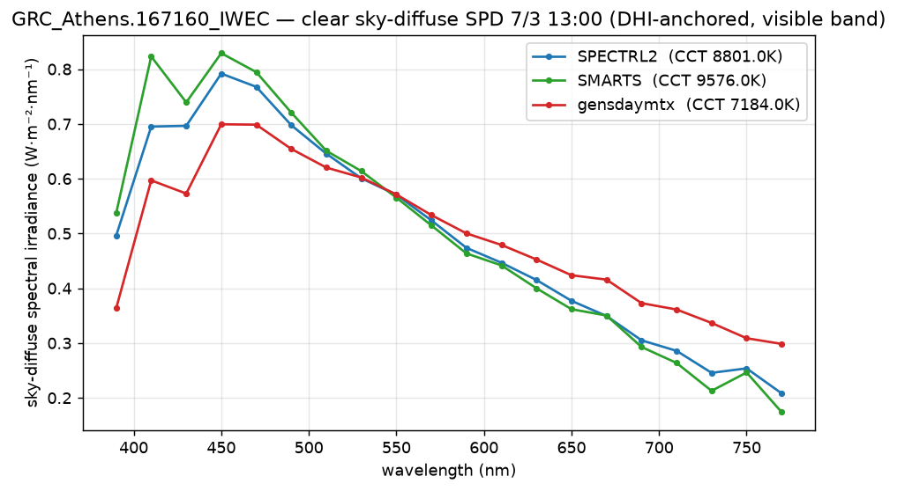

**CCT vs clearness — the headline divergence, every daylight hour.** SPECTRL2 (blue) fans up toward
20 000–30 000 K as Kt → 0; gensdaymtx (red) stays clamped at ~6 500–8 000 K across the whole range.

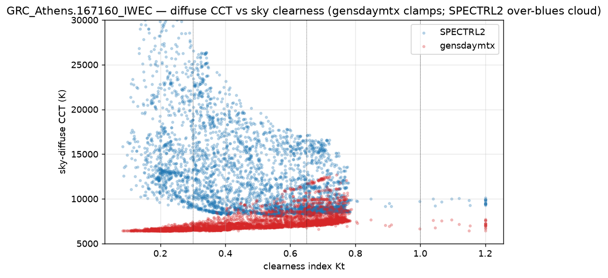

**CCT distribution by clearness** (box = IQR, line = median). The overcast SPECTRL2 box is both higher
and far wider — the regime where the metric itself becomes fragile.

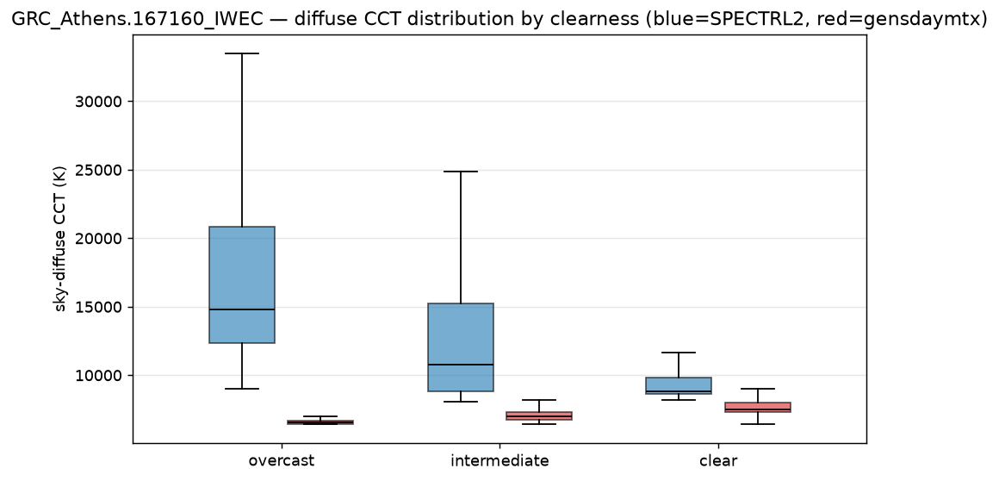

> **What these charts are.** They record the **engine-vs-engine divergence pattern** — the shape of the
> fan, the clamped gensdaymtx line, the widening under cloud — and **not** either engine's absolute
> accuracy. Athens overcast median is **14 815 K** (IQR 12 336–20 830, n = 807) against gensdaymtx's
> clamped **6 528 K**; across all ten cities the overcast median spans **11 650–18 392 K**. These are the
> shipped re-anchored faithful default's own output.
>
> ⚠️ **The clear end is not a baseline.** The clear-Kt blue box (~8 000–8 500 K) invites reading SPECTRL2
> as "about right when clear, over-blue only under cloud". It is not: the clear-sky baseline is itself the
> dominant residual, which is what the optional, default-off `K(λ)` targets — see
> [validation §5](spectral-engine-validation.md).

**mel-EDI Δ% (gensdaymtx − SPECTRL2), binned Kt × zenith.** Near zero for clear mid-sun (top-left),
down to **−25.5 %** in the worst overcast cell (60–75° zenith) — the circadian bottom line. Cell values,
on the shipped default:

| clearness | 0–30° | 30–60° | 60–75° | 75–90° |
|---|---|---|---|---|
| overcast | −18.0 | −21.5 | **−25.5** | −21.8 |
| intermediate | −16.9 | −15.3 | −10.0 | −11.5 |
| clear | −6.0 | +0.9 | +8.8 | −24.2 |

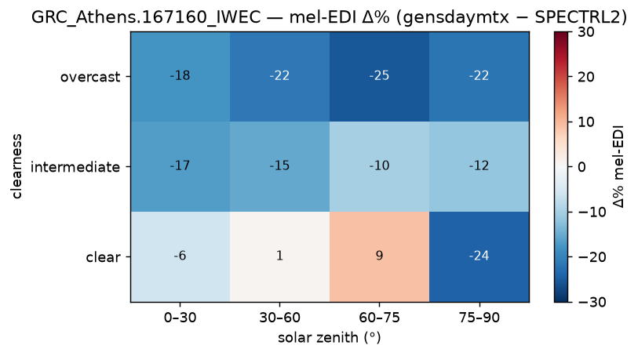

> ⚠️ **"Near zero at clear mid-sun" does not mean "correct there".** That corner measures only that the
> **two engines agree**, and agreement is not accuracy. The overcast bin mean is **−22.6 %** and the most
> negative cell is **−25.5 %**; no cell reaches −29 %.

**Absolute magnitude agreement.** Broadband visible-diffuse Δ% is tight and centred near zero for clear
skies (DHI-anchoring), widening and skewing under overcast where the energy partitions differ.

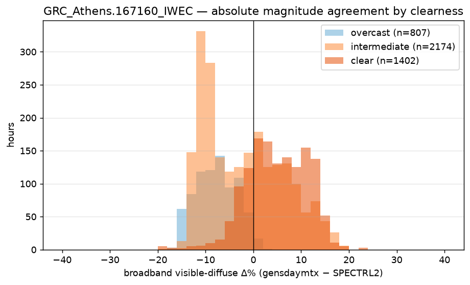

**The angular budget the irradiance engines discard.** Circumsolar concentration peaks ~39 % for clear
high-sun and collapses under cloud; horizon brightening grows with solar zenith.

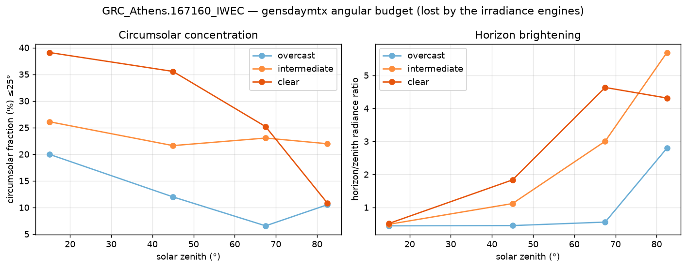

## The sky dome you can't see in a single number (fisheye renders)

`render_fisheye.py` (`run_fisheye.sh`) renders the **Perez sky** (via `gendaylit`) through an **angular fisheye** looking straight up from the dome centre at 1 m —
680 × 680, rendered at 2× and `pfilt`-downsampled for crispness, output as **HDR** plus a tone-mapped PNG
and a cd·m⁻² falsecolor PNG. These make the angular-budget table visible: what a horizontal-diffuse scalar
throws away.

|                                                                                         | tone-mapped                                                       | luminance (cd·m⁻²)                                                           |
| --------------------------------------------------------------------------------------- | ----------------------------------------------------------------- | ------------------------------------------------------------------------------- |
| **Clear, high sun** (z≈23°) — sharp circumsolar peak, bright dome              | 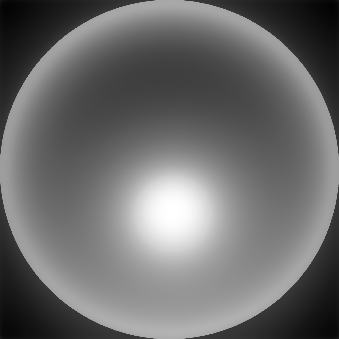      | 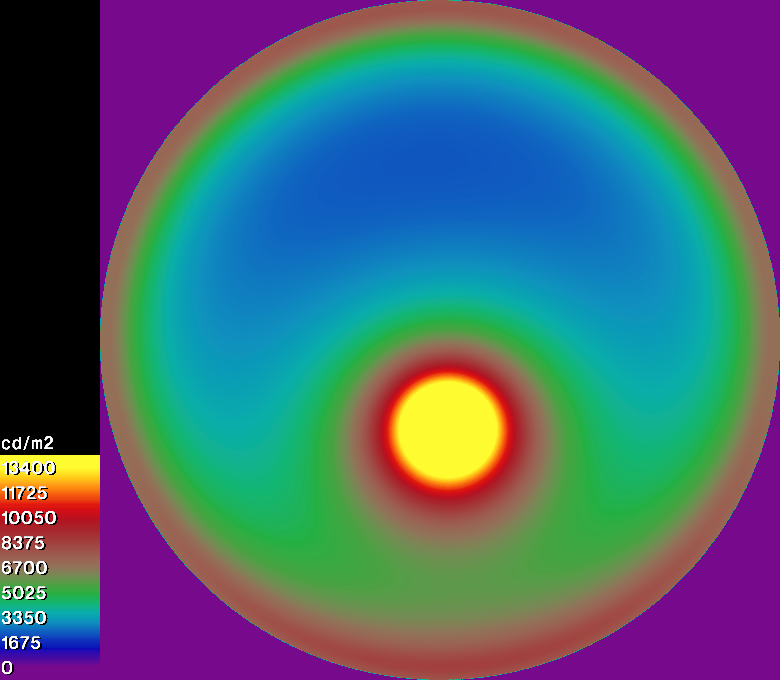      |
| **Clear, low sun** (z≈72°) — circumsolar near the rim, strong horizon gradient | 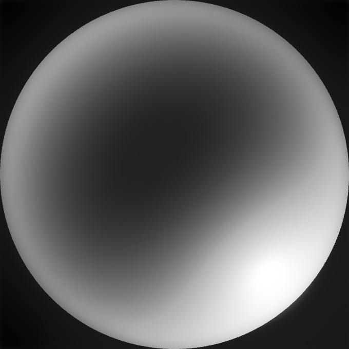 | 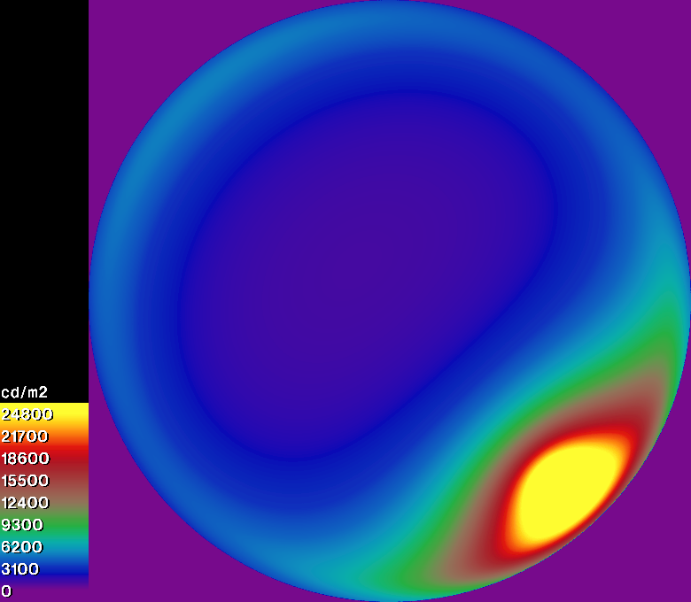 |
| **Overcast midday** (DNI=0) — flatter, smoother, no sharp circumsolar            | 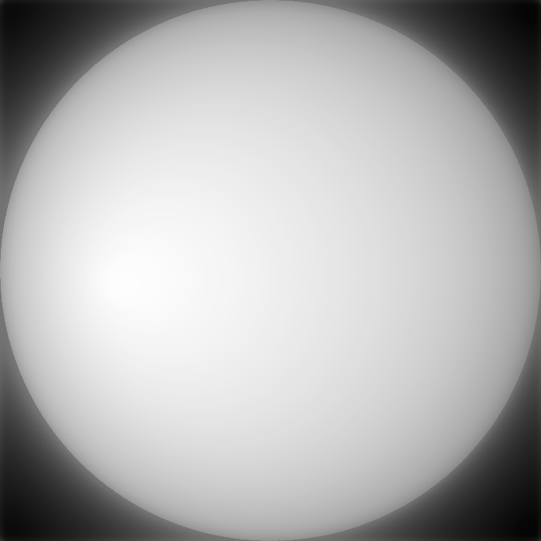   | 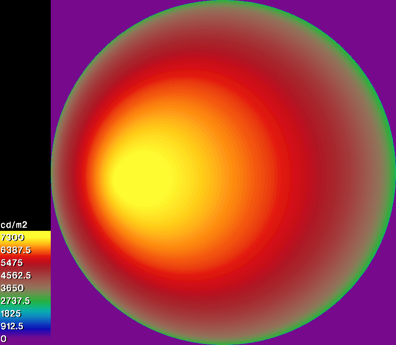   |

The clear-sky falsecolor shows a ~13 000 cd·m⁻² circumsolar hotspot over a 3 000–6 000 cd·m⁻² dome; the
overcast map is a smooth 2 000–7 000 cd·m⁻² gradient with no hotspot. **SPECTRL2 and SMARTS collapse each
of these entire images to one number** — the error that the circumsolar / horizon / anisotropy metrics
quantify, and that matters for any vertical or view-directional (eye-level) receiver.

> *(HDR `.hdr` files sit beside the PNGs in `img/spectral-deep-dive/renders/`; the auto-picked scenarios
> are the clearest high-sun, clearest low-sun, and lowest-Kt midday hours in the EPW. Override with
> `HCL_RENDER_HOURS=M/D/H,…`.)*

## Per-engine sky comparison + the true spectral fisheye

The renders above use `gendaylit` (a smooth Perez sky) to show what the dome *looks like*. To compare the
**three engines on the same hour**, `render_engines_fisheye.py` (`run_engines_fisheye.sh`) paints each
engine's actual sky onto the **G1/G2-validated Reinhart MF:1 dome** projected into the same upward
fisheye, on a **common absolute cd·m⁻² scale**:

- **gensdaymtx** is rendered from its **true 145-patch × 20-band `.smx`** — real angular *and* spectral
  structure, absolute-anchored through the −O0 visible closure (G3). **This is the spectral fisheye** the
  open-item asked for: the 20 bands are integrated to XYZ→sRGB per patch (and to cd·m⁻² and to a
  melanopic-weighted map). The Reinhart patch tiling is visible — that *is* the MF:1 discretization.
- **SPECTRL2** and **SMARTS** have **no angular sky model**, so they are rendered as the **isotropic dome
  they implicitly assume** — every sky patch the same radiance `= (diffuse SPD)/π` — coloured by each
  engine's own spectrum. A flat disc is the honest depiction of "one diffuse number for the whole sky".

### Why SPECTRL2 and SMARTS cannot have a sky image (and why isotropic is the *faithful* render)

This is worth stating precisely, because it is the crux of the whole comparison — not a rendering
convenience.

**What the two engines actually emit.** SPECTRL2 and SMARTS are **one-dimensional** radiative-transfer
models. They solve transport along a *single* path — the direct solar beam through the slant atmosphere —
and return two spectra per hour:

```
direct_normal(λ)            — irradiance along the sun ray            (W·m⁻²·nm⁻¹)
sky_diffuse_horizontal(λ)   — ONE bulk number for all scattered light (W·m⁻²·nm⁻¹)
```

The diffuse term is a **scalar per wavelength**: the total scattered power landing on a *horizontal*
surface. There is no `L(θ,φ)` — the models never resolve which direction the skylight comes from. (That is
by design: Bird & Riordan and Gueymard set out to predict irradiance on a plane, not sky luminance.)

**Why uniform is the only honest sky to draw from that.** A horizontal sensor reports

```
E_diffuse(λ) = ∫_dome L(θ,φ,λ) · cosθ dΩ
```

Infinitely many radiance distributions `L` integrate to the *same* `E_diffuse`. The single distribution
that assumes **no directional information** — the maximum-entropy / structure-free choice — is the uniform
one, `L_iso(λ) = E_diffuse(λ)/π` (because `∫_hemisphere cosθ dΩ = π`, the same π as gate **G1**). So the
flat disc is not us simplifying SPECTRL2/SMARTS; it is the **most that can be drawn** from their output
without **inventing** angular structure they never computed. Painting a circumsolar peak onto a SPECTRL2
sky would be fabricating data.

**Why it still matters (the HCL consequence).** For a **horizontal** receiver the distribution is
irrelevant — all three engines agree on `E_diffuse` by construction (the DHI anchor), so isotropic is
*exactly right*. The error appears the moment the receiver is **not** horizontal:

- A **vertical façade** under an isotropic sky receives `E_v = E_diffuse/2` (unobstructed view factor ½),
  *independent of orientation*. Under the real Perez sky it receives far **more** when facing the
  circumsolar region and **less** facing away — and the angular budget says how much: up to **39 %** of
  the clear-sky diffuse sits within 25° of the sun, and the horizon-to-zenith radiance ratio runs **3–6×**
  at low sun. An isotropic sky smears all of that uniformly.
- **Eye-level melanopic exposure is directional and near-vertical** (a person looks ahead, not up), so for
  circadian (HCL) design the angular concentration is first-order, not a detail. This is precisely where a
  single horizontal-diffuse number is least adequate — and where gensdaymtx's `l(ζ,γ)` earns its keep.

> **Read the renders as:** the *flatness* of the SPECTRL2/SMARTS discs is the modelling assumption made
> visible — correct for a roof, wrong for a window or an eye. Only the *colour* differs between the two
> (SMARTS marginally bluer). gensdaymtx is the only engine with a circumsolar peak, horizon brightening
> and a zenith gradient — the structure the angular budget quantifies and the façade/eye actually sees.

**Clear summer noon** (7/15 13:00, zenith 16°) — gensdaymtx concentrates a bright circumsolar core near
the centre; the irradiance engines are uniform:

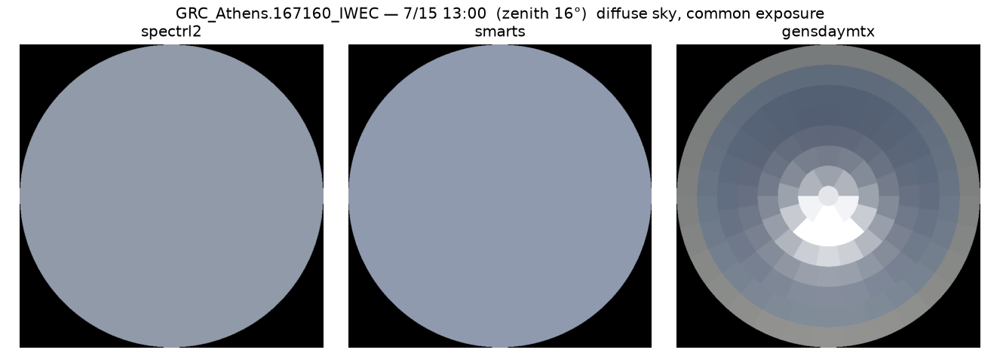

**Clear low sun** (1/16 16:00, zenith 72°) — the gensdaymtx hotspot moves to the rim (sun near the
horizon) with strong horizon brightening; the flat discs simply dim:

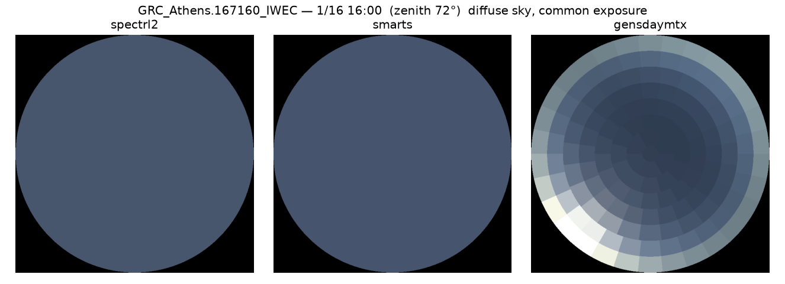

**Overcast midday** (5/13 09:00, DNI=0, zenith 54°) — gensdaymtx is smooth with no sharp circumsolar; all
three are closest here in *shape*, but differ in colour (the CCT gap):

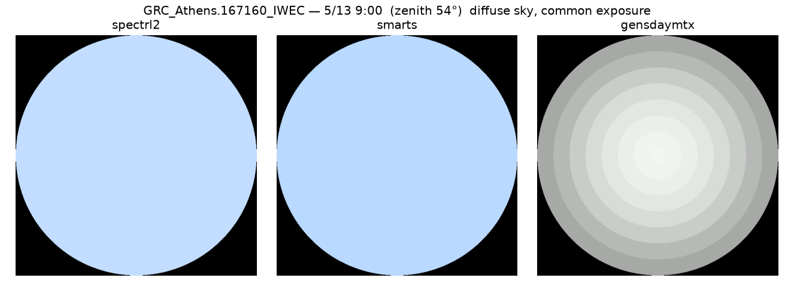

**Equinox noon** (3/21 12:00, zenith 41°) — the mid-sun reference:

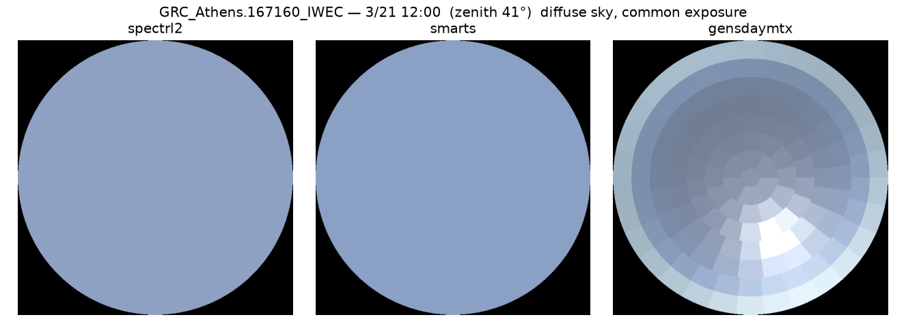

The spectral payoff, gensdaymtx clear-noon — the **luminance** (cd·m⁻²) and **melanopic** distributions
over the dome, straight from the 20-band `.smx`. A horizontal sensor integrates each of these to a single
number; a vertical or view-directional (eye-level) receiver does not:

| luminance (photopic)                                                                                              | melanopic (circadian)                                                                                            |
| ----------------------------------------------------------------------------------------------------------------- | ---------------------------------------------------------------------------------------------------------------- |
| 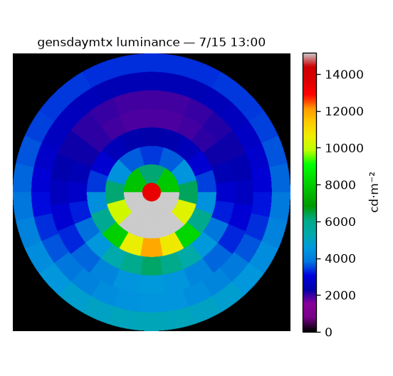 | 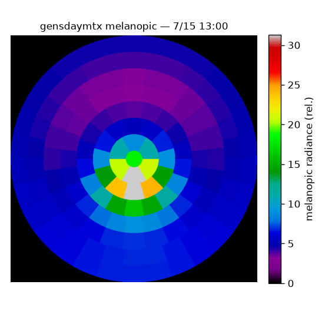 |

> **Method note.** This is a direct projection of each engine's output onto the validated dome geometry
> (equivalent to an unobstructed up-looking view — no interreflection to compute), *not* an `rpict`
> path-trace. It is faithful to the engine data (the real `.smx` patch radiances; the real SPECTRL2/SMARTS
> SPDs) and to the Reinhart geometry the G1/G2 gates pin down. A full `rfluxmtx` image-matrix render would
> add anti-aliased patch edges but not change the radiance values.

### Latitude contrast — Chania (35.5°N) · Athens (37.9°N) · Thessaloniki (40.5°N)

The same renderer, run on all three cities, isolates what latitude actually changes in this Greek
triplet. Because the three EPWs share nearly identical aerosol and humidity (AOD 0.16–0.21, PWV
2.0–2.5), the **colour/CCT barely moves** city-to-city and the SPECTRL2/SMARTS isotropic discs are
essentially interchangeable — the cross-city signal is **purely geometric**, carried only by gensdaymtx's
angular term. Two views make it visible (gensdaymtx, tone-mapped; each panel is normalized to its own
hour, so read **hotspot position**, not absolute brightness):

**Clear summer noon (7/15 13:00).** Solar zenith rises with latitude — Chania 14°, Athens 16°,
Thessaloniki 19° — so the circumsolar core sits closest to the centre (zenith) at the southern site and
walks measurably off-centre going north:

| Chania 35.5°N (z 14°)                                                                          | Athens 37.9°N (z 16°)                                                                       | Thessaloniki 40.5°N (z 19°)                                                                      |
| ------------------------------------------------------------------------------------------------ | --------------------------------------------------------------------------------------------- | -------------------------------------------------------------------------------------------------- |
|  |  |  |

**Winter low sun (1/16 16:00).** The hotspot is pinned near the rim for all three (zenith 70–73°); the
higher-latitude sites sit fractionally lower (closer to the horizon), deepening the horizon-to-zenith
gradient:

| Chania (z 70°)                                                                                 | Athens (z 72°)                                                                              | Thessaloniki (z 73°)                                                                             |
| ----------------------------------------------------------------------------------------------- | -------------------------------------------------------------------------------------------- | ------------------------------------------------------------------------------------------------- |
| 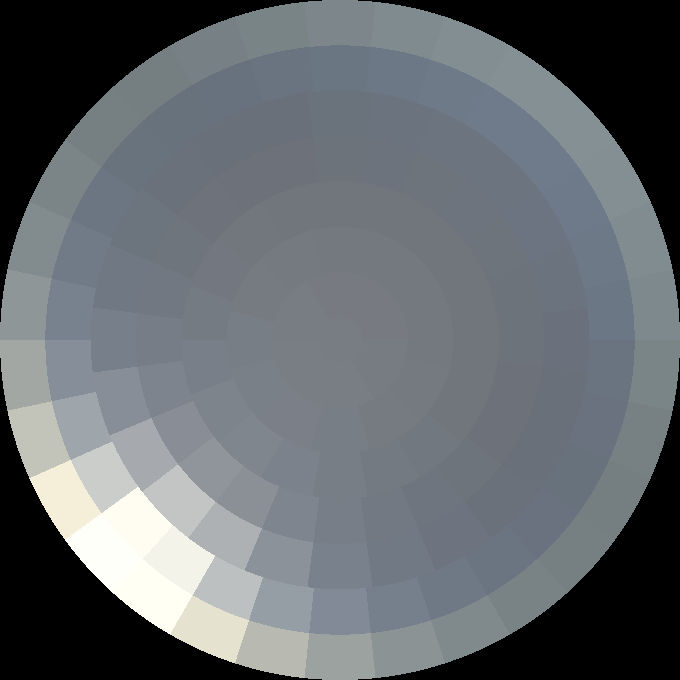 | 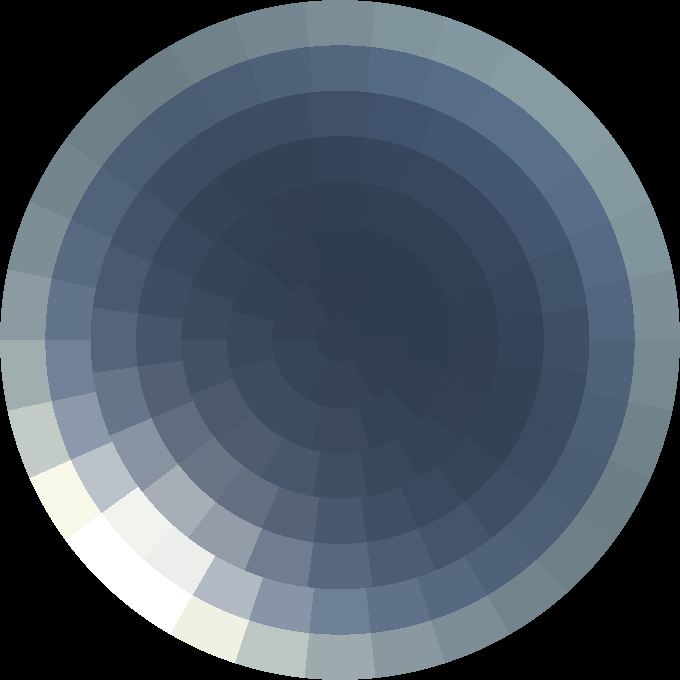 | 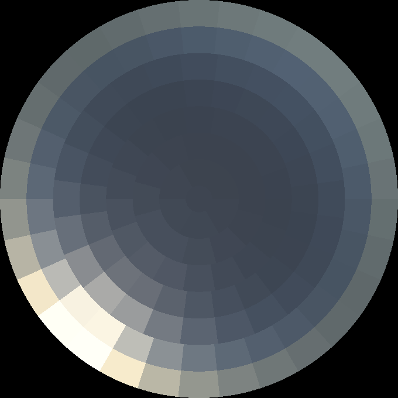 |

The full three-engine comparison holds in every city — here Thessaloniki, clear noon, with the same
flat-but-blue vs structured-and-warm contrast as Athens:

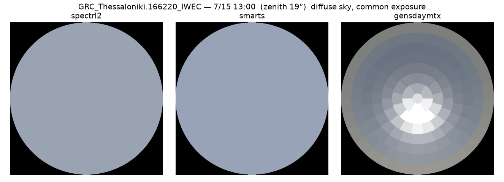

**Analysis.** Three things follow, and they reinforce the headline cross-city result:

1. **Latitude moves geometry, not spectrum.** The visible city-to-city difference is the *position* of
   the circumsolar peak (a few degrees of solar zenith) — a property of the sun, not the atmosphere. The
   diffuse *colour* is nearly identical across the three. To move the **spectral** axis you must change
   aerosol/humidity, not latitude alone — i.e. a genuinely different climate, not another Greek city. The
   [wider 10-city set](#cross-city-the-wider-epw-set) **confirms this directly**: the CCT gap is carried by
   **PWV / cloudiness** (partial r = +0.37), while latitude's pull collapses to −0.09 once humidity is held
   — the Greek triplet's flat colour was the special case, not the rule.
2. **The isotropic engines are latitude-blind in shape.** SPECTRL2/SMARTS render as the same flat disc in
   every city (only its overall level tracks that hour's DHI); they encode no sun-position information in
   the *sky*, only in the separate direct beam. gensdaymtx is the only engine whose **sky** changes with
   where the sun is.
3. **Higher latitude amplifies the angular error of an isotropic sky.** Northern sites spend more of the
   year at high solar zenith (the winter-low-sun regime), where the horizon/zenith ratio is largest and
   the circumsolar peak hugs the rim. That is exactly the regime where collapsing the sky to one
   horizontal-diffuse number is least adequate for a vertical façade or an eye — so the case for the
   angular model *strengthens* with latitude even when the spectral case does not.

### Equator vs pole: Singapore vs Stockholm

Singapore (1.4°N) vs Stockholm (59.1°N). The Greek triplet spans only 5° of latitude. Re-running the **same** per-engine renderer on the two
extremes of the wider set makes the geometric argument unmissable. Each panel is gensdaymtx, tone-mapped
and normalized to its own hour (so read **hotspot position**, not absolute brightness); the hours are each
city's clearest summer-noon and clearest winter-midday (zenith annotated):

|                                         | Singapore (1.4°N)                                                                              | Stockholm (59.1°N)                                                                                      |
| --------------------------------------- | ----------------------------------------------------------------------------------------------- | -------------------------------------------------------------------------------------------------------- |
| **Summer noon** (z 23° / 37°)   |  | 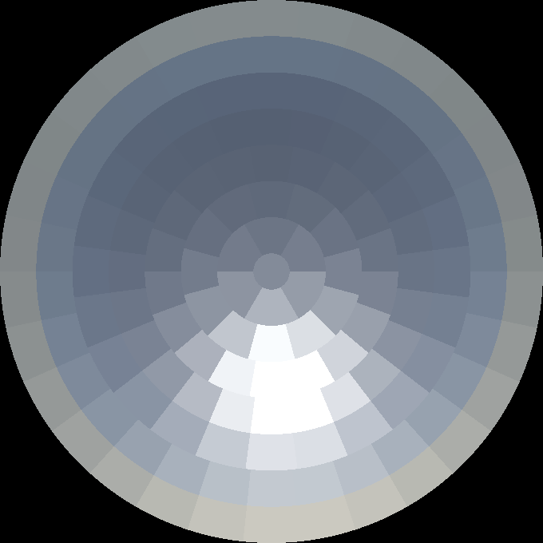 |
| **Winter midday** (z 20° / 71°) |  | 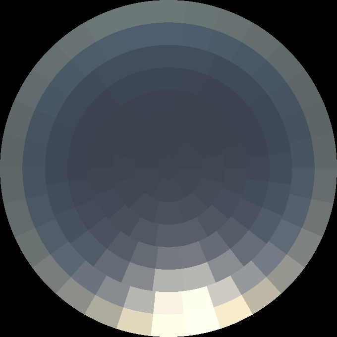 |

Read down the columns:

- **Singapore is seasonless.** Its circumsolar core sits near the **zenith (image centre) in both rows** —
  the solar zenith barely moves (23° summer → 20° winter), so the two panels are nearly identical. An
  equatorial sky carries almost **no seasonal geometry**: the sun is overhead year-round.
- **Stockholm swings the full dome.** The core **walks from mid-dome in summer (37°) to the rim in winter
  (71°)**, where the **zenith goes dark blue and the horizon glows warm** — a sky dominated by a low-sun
  horizon gradient for much of the year.
- **The isotropic-engine error is climate-specific.** Collapsing either sky to one horizontal-diffuse
  number is nearly harmless for Singapore's near-overhead dome but **discards almost everything that
  matters** at Stockholm in winter (where a vertical façade or an eye sees a bright warm horizon band and a
  dark zenith). This is point 3 above, now demonstrated across a **58° latitude span** instead of 5° —
  and it closes the "extend the renders to Singapore/Stockholm" open item.

## Sampling and runtime notes

`gensdaymtx` runs **once per year per city**. SMARTS is one external process per hour and so covers only a
deterministic stratified subsample (`HCL_SMARTS_CAP`, default 200 h/city). SMARTS is optional — without it
the SPECTRL2-vs-`gensdaymtx` results that carry the cross-city analysis are unaffected — but `SMARTSPATH`
must point at the **binary, not its directory**, since set-but-wrong skips silently.

⚠️ Radiance's `atmos_data` scattering cache (~3 GB) **rebuilds itself on the first `gensdaymtx` run**.
Expect the first invocation to be much slower than later ones.


## Open items (carried from the plan)

- **Wider cross-city set — DONE & de-confounded.** Ten cities now span 3.0°S–59.1°N (Greek triplet +
  Singapore, Phoenix, London, Stockholm + humid-tropical Manaus, Lagos, Mumbai; AOD 0.09–0.21,
  PWV 1.5–4.8). The CCT gap is driven by **PWV / cloudiness** (partial r = +0.37 vs latitude's −0.09; AOD
  inert), robust across four tropical climates — see the [cross-city section](#cross-city-the-wider-epw-set).
  The per-engine **fisheye renders were extended to Singapore & Stockholm**
  ([equator-vs-pole](#equator-vs-pole-singapore-vs-stockholm)). **Remaining:** the latitude↔PWV collinearity
  (r = −0.92) is intrinsic to real climates — a humid *high-latitude* or arid *low-latitude* site (e.g.
  Reykjavík, Khartoum) would tighten the partial-correlation estimate further.
- **Direct-normal absolute** stays a *shape* comparison at MF:1 (the beam smears across a few patches);
  diffuse is the clean absolute metric.
- **CCT robustness** — the median-CCT guard is described (per-bin median vs the mean that blows up to >50 000 K); the locus-distance/duv cutoff to make the per-hour value trustworthy remains the only open refinement here.
- **Clear-sky bias K(λ) — DONE (optional / default-off).** The residual SPECTRL2 clear-sky blue bias is addressed by the optional warming filter K(λ); see [validation §5](spectral-engine-validation.md).
- **`rpict`/`rfluxmtx` image-matrix renders** — the per-engine fisheyes are direct projections of the
  validated dome (correct radiances, equivalent to an unobstructed up-view). A full `rfluxmtx` view-matrix
  path would add anti-aliased patch edges and let geometry/obstructions interact with the sky; not needed
  for the open-sky comparison here.
